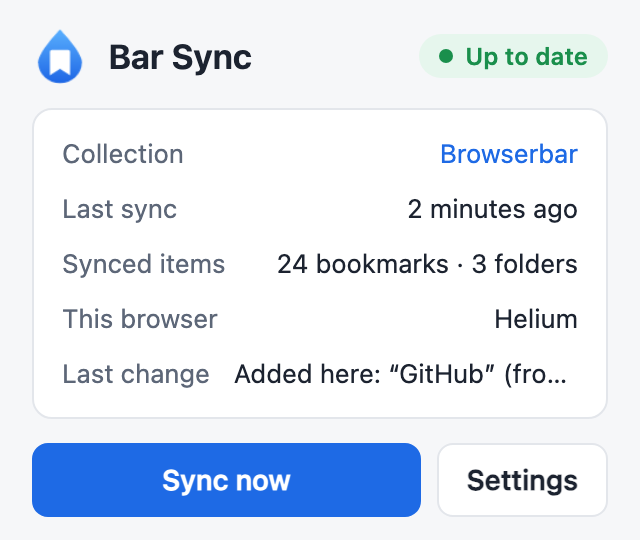
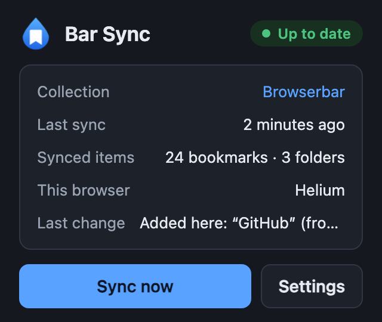
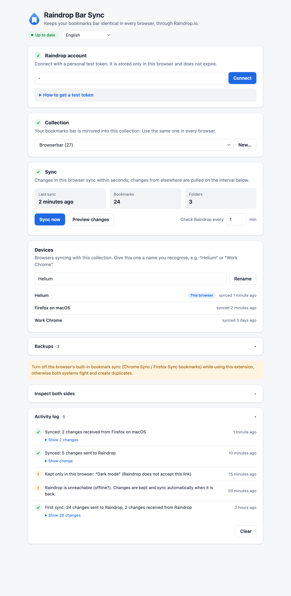

# Raindrop Bar Sync

**借助 Raindrop.io，让浏览器的书签栏在每个浏览器中都保持一致。**

[English](README.md) · [Türkçe](README.tr.md) · [Deutsch](README.de.md) · [Русский](README.ru.md) · [日本語](README.ja.md) · [Español](README.es.md) · **简体中文** · [Português (BR)](README.pt-BR.md)

这是一个浏览器扩展，可将 Chrome、Edge、Brave、Vivaldi、Helium 和 Firefox 的**原生书签栏**与一个
Raindrop.io 收藏集进行双向同步。在 Firefox 中添加一个书签，一分钟后它就会出现在 Chrome 的书签栏里，
位于同一个文件夹、同一个位置。Raindrop 充当服务器，你无需再托管任何东西。

<p align="center">
  
  &nbsp;
  
</p>

## 为什么

- Chrome Sync 和 Firefox Sync 只能在各自的浏览器家族内同步。
- Raindrop 官方扩展会把书签保存到 Raindrop，但不会改动浏览器的书签栏。
- 跨浏览器的书签同步工具需要你另外配置存储（Nextcloud、WebDAV、Google Drive……）。如果你已经在用
  Raindrop，本扩展就把它当作这个存储。

## 功能

- 书签栏及其子文件夹的**双向同步**：在任一侧添加、重命名、修改链接、移动和删除。
- **完全一致的顺序**，包括文件夹与书签交错排列的顺序。Raindrop 本身无法保存这一点，因此顺序保存在
  收藏集中的小型隐藏备注里。
- **以最后的更改为准**：按书签、按字段，依据你实际做出更改的时间判断，即使某个浏览器离线了好几天。
- **不会意外丢失**：首次同步只添加不删除；一侧删除了文件夹而另一侧往其中添加了内容时，文件夹会被恢复；
  大量删除会暂停并请求确认。
- 每次更改前**备份**此浏览器的书签栏，一键即可恢复。
- **活动日志**记录每一次更改及其来源（“来自 Firefox”）。
- **设备列表**显示与该收藏集同步的所有浏览器。
- **支持离线**：离线时的更改会被保留，恢复连接后再发送。
- 弹出窗口和设置支持 **16 种语言**，并提供浅色与深色主题。
- 无服务器、无统计分析，除 `bookmarks`、`storage`、`alarms` 和 `api.raindrop.io` 外不需要任何权限。



## 安装

扩展尚未上架 Chrome 网上应用店或 addons.mozilla.org，请从源码构建。需要
[Node.js](https://nodejs.org) 20 或更高版本。

```sh
git clone https://github.com/ozardali/raindrop-bar-sync.git
cd raindrop-bar-sync
npm install
npm run build            # Chrome, Edge, Brave, Vivaldi, Helium…
npm run build:firefox    # Firefox
```

**Chromium 系浏览器**：打开 `chrome://extensions`，开启**开发者模式**，点击**加载已解压的扩展程序**，
选择 `.output/chrome-mv3`。

**Firefox**：打开 `about:debugging#/runtime/this-firefox`，点击**临时载入附加组件…**，选择
`.output/firefox-mv3/manifest.json`。临时附加组件会在 Firefox 退出时被移除；如需长期安装，请运行
`npm run zip:firefox`，并在 [addons.mozilla.org](https://addons.mozilla.org/developers/) 上将 zip
签名为不公开（unlisted）的附加组件。

## 设置

1. **先备份你的书签**（书签管理器 → 导出）。同步操作的是真实数据。
2. 在使用本扩展的浏览器中关闭自带的书签同步（Chrome Sync / Firefox Sync）。同一个书签栏上有两套同步
   系统会互相冲突并产生重复项。
3. 点击扩展图标 → **设置**。
4. **Raindrop 账号**：粘贴一个测试令牌。页面会一步步告诉你如何获取：Raindrop → 设置 → 整合方式 →
   *创建新应用* → *创建测试令牌*。该令牌只能访问你自己的账号，且不会过期。
5. **收藏集**：选择用来映射书签栏的收藏集，或新建一个。**在每个浏览器中使用同一个收藏集**。
6. 完成。首次同步会合并两侧：双向补齐缺少的内容，不删除任何东西。

此后，浏览器中的更改会在几秒内发送到 Raindrop，其他浏览器的更改会在一分钟内（可调整）同步过来。

## 工作原理

每次同步都会比较三棵树：当前的书签栏、当前的收藏集，以及上次同步时两侧达成一致的状态。只在一侧发生的
更改会复制到另一侧；如果两侧都改了同一项，较新的更改胜出。合并逻辑是一个纯函数，配有单元测试、属性测试
和模糊测试：数百个随机编辑历史，每一个都要求最终两侧一致且不丢失任何新内容。

详情见 [docs/architecture.md](docs/architecture.md)。设计所依赖的、经真实 API 验证的 Raindrop API
行为见 [docs/raindrop-api.md](docs/raindrop-api.md)（英文）。

## 限制

- 只同步书签栏（及其文件夹），不包括“其他书签”或“移动设备书签”。
- 分隔线（Firefox）不会同步，Raindrop 中没有对应的东西。
- Raindrop 不接受的链接（`javascript:` 书签小工具、`file:`、`about:`）会留在原浏览器中，且永远不会被
  删除。
- 不支持 Android 版 Firefox 和 Safari。
- Vivaldi 和 Brave 应该与 Chrome 一样可用，但尚未测试。
- 通过测试令牌登录；“使用 Raindrop 登录”（OAuth）需要服务器端的密钥，暂未实现。

## 免责声明

**这是一个非官方项目，与 Raindrop.io 无关，也未获得 Raindrop.io 的认可。**

**同步会修改两处的真实数据。** 各项保护措施（首次同步不删除、大量删除前暂停、本地备份、Raindrop 回收站）
让丢失书签变得不太可能，但并非不可能。请保留一份可以恢复的书签导出文件。

**不提供任何担保。** 本软件按“原样”提供，采用 [MIT 许可证](LICENSE)。

## 隐私

扩展只与一个服务器通信：`api.raindrop.io`（使用你的令牌）。没有统计分析，没有第三方。具体哪些数据
保存在哪里，请见 [PRIVACY.md](PRIVACY.md)（英文）。

## 翻译

扩展界面提供 Raindrop 应用所支持的 16 种语言。本 README 提供顶部链接中的语言版本。两者都**以英文为准**；
如果译文与原文不一致，以英文为准。如何修正或添加翻译：[CONTRIBUTING.md](CONTRIBUTING.md#translations)。

## 参与贡献

欢迎提交问题报告和 Pull Request。开发环境、测试和项目结构见 [CONTRIBUTING.md](CONTRIBUTING.md)。

## 许可证

[MIT](LICENSE) © Goksel Ozardali
